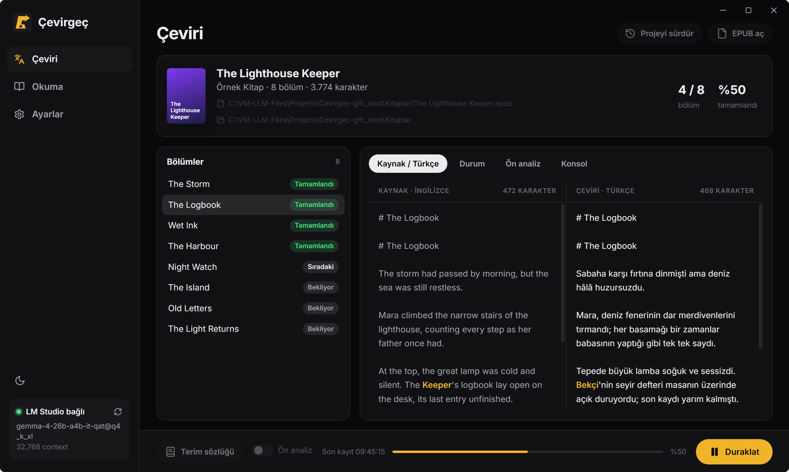

<div align="center">
  <picture>
    <source media="(prefers-color-scheme: dark)" srcset="assets/logo-dark.svg">
    
  </picture>
</div>



Çevirgeç, DRM içermeyen EPUB kitaplarını LM Studio'da çalışan yerel bir modelle İngilizceden Türkçeye çevirmek için geliştirilmiş masaüstü uygulaması ve komut satırı aracıdır. Kaynak EPUB'u bölümlere ayırır, çeviriyi güvenli kontrol noktalarıyla yürütür ve görselleri, temel metadata alanlarını ve EPUB içi bağlantıları koruyarak yeni bir EPUB oluşturur.

> **English:** Çevirgeç is a Turkish GUI and CLI application for translating DRM-free EPUB books with a local model served by LM Studio. It supports resumable checkpoints, optional book analysis, terminology enforcement and EPUB reconstruction.

> [!IMPORTANT]
> Uygulamayı yalnızca çevirme ve dönüştürme hakkına sahip olduğunuz, DRM içermeyen dosyalarda kullanın. Model çıktısı yayımlanmadan önce insan tarafından gözden geçirilmelidir.

## Başlıca özellikler

- Aynı çeviri çekirdeğini kullanan modern masaüstü arayüzü (Svelte + pywebview, koyu/açık tema) ve CLI
- LM Studio'da yüklü modelleri algılama ve model seçimi
- EPUB içindekiler yapısına göre bölüm içe aktarma
- Görsel, kapak, temel metadata, tablo, dipnot ve iç bağlantı koruması
- Yapısal EPUB işaretlerini doğrulama ve güvenle geri yerleştirilebilen çapaları otomatik onarma
- Kitaba özel zorunlu terim sözlüğü ve isteğe bağlı ön analiz
- Parça bazlı atomik kontrol noktaları, duraklatma ve proje sürdürme
- Ayarlanabilir otomatik yeniden deneme ve context/token ön kontrolü
- Dahili EPUB doğrulaması ve isteğe bağlı EPUBCheck
- Okuma sekmesi: kendi EPUB kitaplığınız, kaldığı yerden devam, yer imleri, yazı/sayfa ayarları
- Tak-çıkar ses motorlarıyla çevrimdışı sesli okuma: Türkçe için [EMA Lightning](https://huggingface.co/canberkkkkkk/ema-lightning), Türkçe/İngilizce için [Piper](https://github.com/OHF-Voice/piper1-gpl); dil başına ses seçimi, cümle vurgulama, hız, bölümü WAV olarak kaydetme. Motorlar uygulama içinden indirilip program klasörüne kurulur.
- Windows için tek dosyalı `.exe` derleme komut dosyası

## Gereksinimler

- Python 3.10 veya üzeri
- [LM Studio](https://lmstudio.ai/) ve yüklü bir sohbet modeli
- Kaynak koddan arayüz için `pywebview` ve arayüzü derlemek için [Node.js](https://nodejs.org/) 20+
- Windows'ta Microsoft Edge WebView2 (Windows 10/11'de hazır gelir)
- Paketleme için `PyInstaller`
- İsteğe bağlı EPUBCheck; JAR kullanılırsa Java

Windows'ta hazır `.cmd` başlatıcıları ve `.exe` derleme desteği vardır. Python, pywebview ve Node.js bulunan diğer sistemlerde uygulama kaynak koddan çalıştırılabilir; Linux ve macOS için hazır paketleme dosyası sağlanmaz.

## Hızlı başlangıç

Bağımlılıkları yükleyin:

```powershell
py -3 -m pip install -r requirements.txt
```

Linux/macOS karşılığı:

```bash
python3 -m pip install -r requirements.txt
```

Ardından:

1. LM Studio'da kullanacağınız modeli yükleyin.
2. Yerel sunucuyu başlatın. Varsayılan adres `http://127.0.0.1:1234/v1` olmalıdır.
3. Windows'ta `GUI_BASLAT.cmd` çalıştırın (ilk açılışta arayüz derlenir). Diğer sistemlerde `web` klasöründe `npm ci && npm run build`, ardından `python3 desktop.py`.
4. **EPUB aç** ile kaynak kitabı seçin; çalışma klasörü varsayılan olarak EPUB'un klasörüdür ve kitap kartından değiştirilebilir.
5. LM Studio durumunu sol alttaki kartta kontrol edin; gerekirse yenileyin.
6. **Çeviriyi başlat** düğmesine basın.
7. Terim sözlüğünü doldurun veya boş bırakın; isterseniz ön analizi etkinleştirin.

Uygulama çalışma klasöründe `<KitapAdı>-ceviri` adlı bir proje oluşturur. İşlem kesilirse **Projeyi sürdür** ile tamamlanan parçalar korunarak devam edilir.

## Belgeler

Ayrıntılı açıklamalar için [KULLANIM.md](KULLANIM.md) dosyasına bakın:

- Arayüz, proje sürdürme ve güvenli yeniden çeviri
- Özel terim sözlüğü ve ön analiz
- Ayarlar, bitiş işareti ve otomatik tekrar davranışı
- Context/token yönetimi ve kontrol noktaları
- EPUB oluşturma, yapısal koruma ve EPUBCheck
- Proje klasörü ve dosyaların görevleri
- CLI kullanımı ve Windows `.exe` oluşturma
- Gizlilik, sınırlamalar ve sorun giderme

Kısa CLI örnekleri:

```powershell
py -3 cevir.py --check
py -3 cevir.py --epub "D:\Kitaplar\kitap.epub"
py -3 cevir.py --book "D:\Kitaplar\kitap-ceviri"
```

## Gizlilik ve sınırlamalar

Çevirgeç kitap metnini yapılandırılmış yerel LM Studio adresine gönderir; kendi başına bir bulut çeviri hizmetine bağlanmaz. Base URL yerel adreslerle sınırlandırılmıştır ve API isteklerinde sistem proxy'si kullanılmaz.

DRM korumalı veya yalnızca taranmış sayfalardan oluşan EPUB'lar desteklenmez. Karmaşık CSS düzenleri, `rowspan`/`colspan`, şiirsel boşluklar ve etkileşimli içerikler sadeleşebilir. Yerel modelin anlamsal eksiksizliği ve çeviri kalitesi insan kontrolü gerektirir.

## Lisans

MIT
